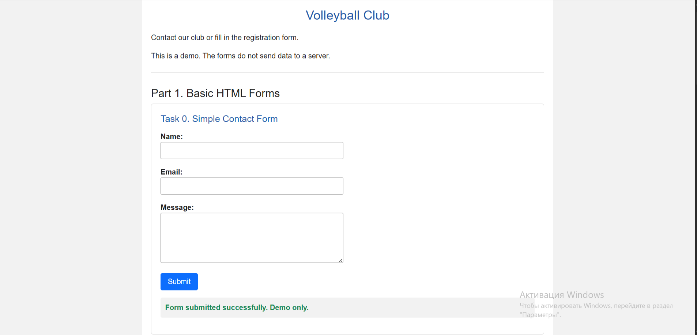
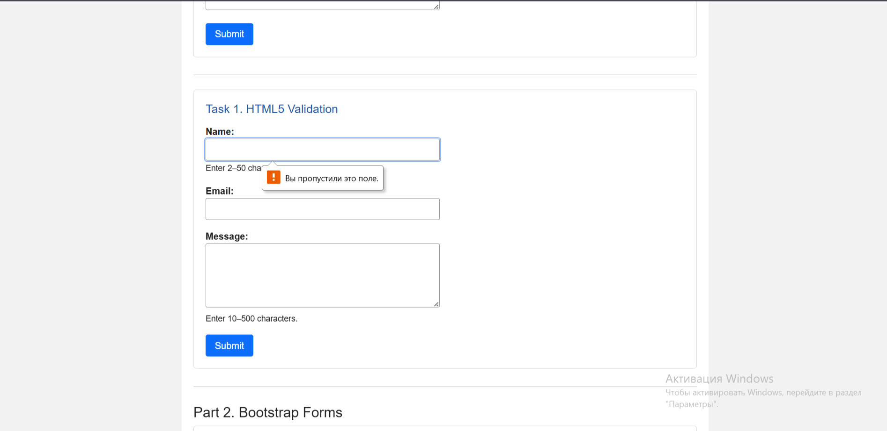
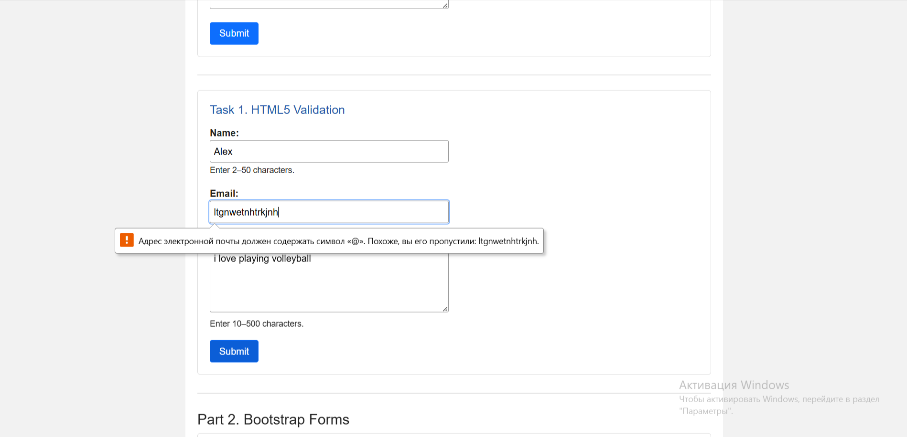
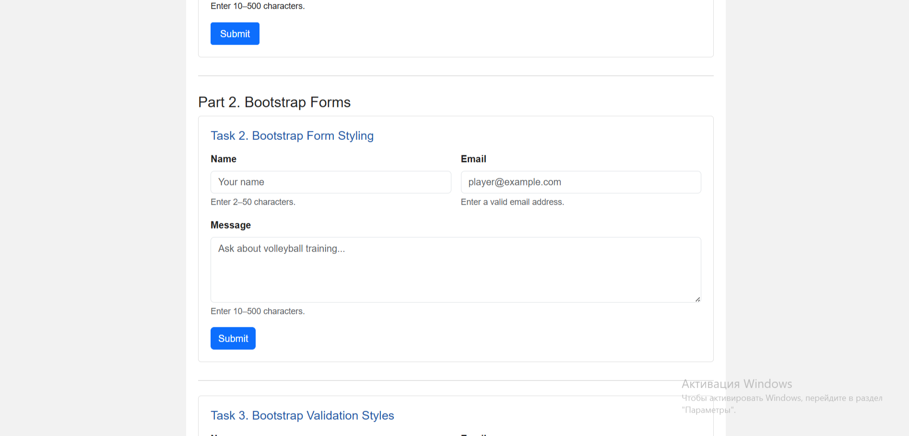
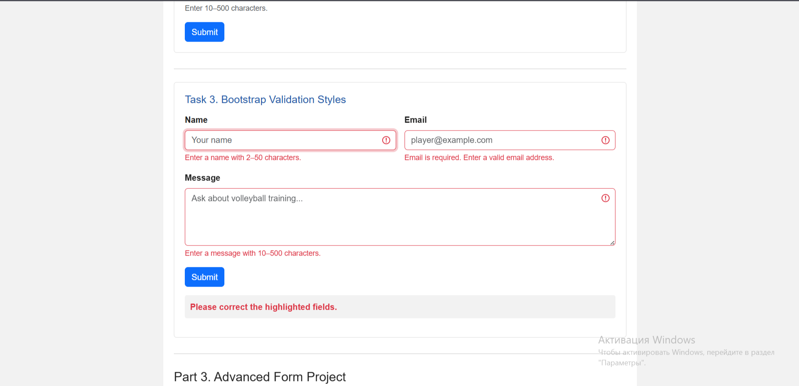
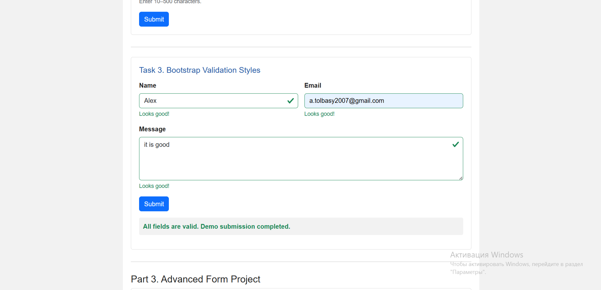
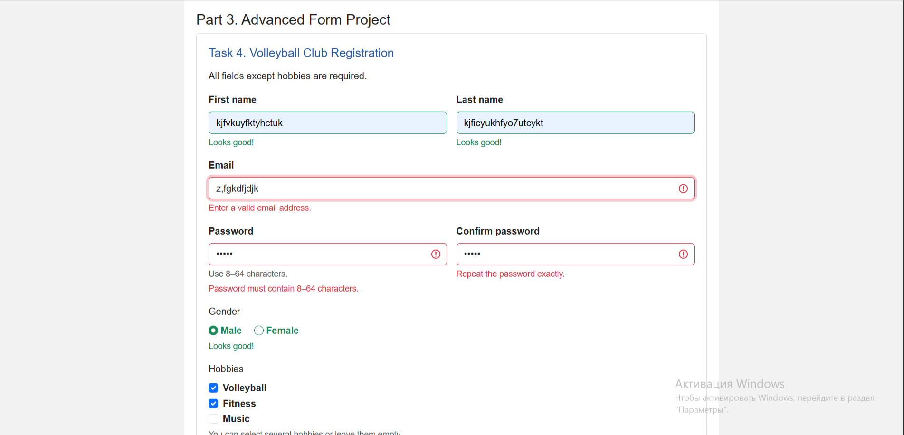
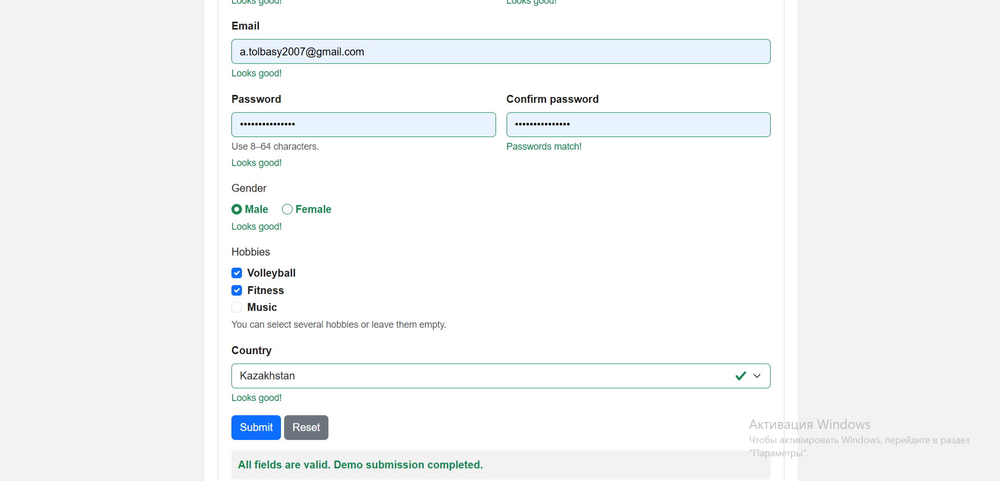
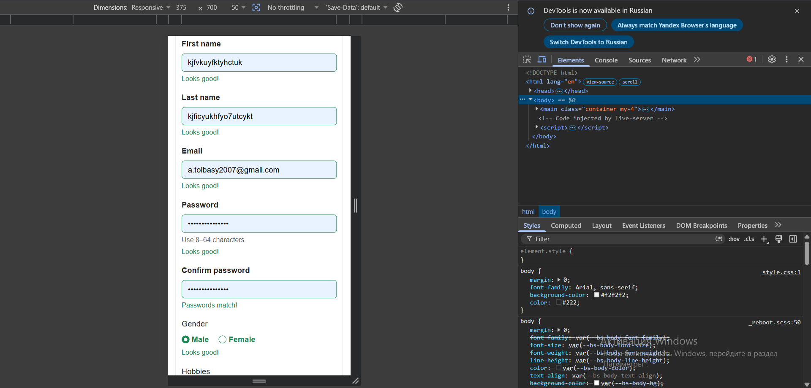

# Assignment 4 — Forms and Validation

Name: YOUR FULL NAME  
Group: YOUR GROUP  
Theme: Volleyball Club

## About the Project

This website contains contact forms and a registration form
for a volleyball club.

The project uses HTML, Bootstrap and JavaScript.

The forms are demonstrations. They do not send data to a server
or create real accounts.

## How to Run

Open `index.html` in a browser.

An internet connection is needed to load Bootstrap.

## Part 1. Basic HTML Forms

### Task 0. Simple Contact Form

The form contains:

- Name input.
- Email input.
- Message textarea.
- Submit button.

Every field has a label connected to its ID.

### Task 1. HTML5 Validation

This form uses:

- `required` for required fields.
- `type="email"` for email validation.
- `minlength` for minimum text length.
- `maxlength` for maximum text length.

The name must contain 2–50 characters.
The message must contain 10–500 characters.

The browser blocks submission when the entered data is invalid.

Empty required field:

Invalid email:

## Part 2. Bootstrap Forms

### Task 2. Bootstrap Form Styling

The form uses Bootstrap classes:

- `form-label`
- `form-control`
- `form-text`
- `btn`
- `btn-primary`

The layout uses `row`, `g-3`, `col-12` and `col-md-6`.

Name and email appear next to each other on wider screens.
They stack vertically on smaller screens.

The form also includes placeholders and helper text.

### Task 3. Bootstrap Validation Styles

JavaScript checks the fields using `checkValidity()`.

Valid fields receive the `is-valid` class.
Invalid fields receive the `is-invalid` class.

Messages below the fields use `valid-feedback` and
`invalid-feedback`.

Invalid data:

Valid data:

## Part 3. Advanced Form Project

### Task 4. Registration Form

The registration form contains:

- First name.
- Last name.
- Email.
- Password.
- Confirm password.
- Gender radio buttons.
- Hobbies checkboxes.
- Country dropdown.
- Submit and Reset buttons.

Bootstrap Grid makes the form responsive.

First and last names require 2–40 characters.
Passwords require 8–64 characters.
Password confirmation must match the password.

Gender and country are required.
Hobbies are optional and allow multiple selections.

Bootstrap feedback shows valid and invalid fields.

Reset clears the entered values, selections, validation styles
and result message.

Invalid registration:

Valid registration:

Mobile layout:

## Work Process

First, a basic HTML contact form was created.
HTML5 validation attributes were then added.

Next, Bootstrap classes were used to style the form and arrange
its fields in a responsive grid.

JavaScript was added to display validation feedback.
Finally, the registration form was created with password matching
and a Reset button.

## Resources

- Abitova G. A. Web Technologies: Front-End Development. Part 1 (2022).
- [Course videos](https://www.youtube.com/playlist?list=PLPT6CF0r4E3rkvy1rLUKdDHf_HmWZeURW)
- [Bootstrap Introduction](https://getbootstrap.com/docs/5.3/getting-started/introduction/)
- [Bootstrap Forms](https://getbootstrap.com/docs/5.3/forms/overview/)
- [MDN Forms](https://developer.mozilla.org/en-US/docs/Learn_web_development/Extensions/Forms)
- [HTML Form Attributes](https://www.w3schools.com/html/html_form_attributes.asp)